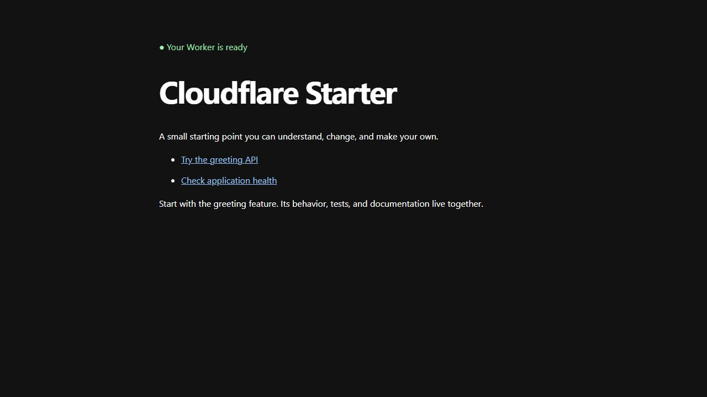
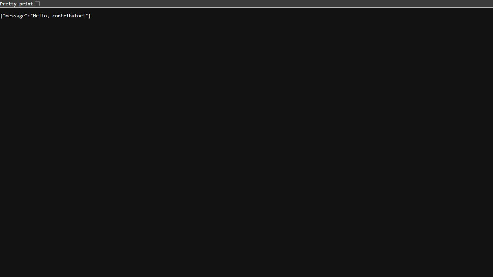

[](https://deploy.workers.cloudflare.com/?url=https%3A%2F%2Fgithub.com%2Fdasarpemrograman%2Fcontributor-cloudflare-starter)

# Contributor Cloudflare Starter

A contributor-friendly TypeScript Worker with a useful first-run page, a small
example API, and an explicit deployment contract. No database, secrets, external
services, or runtime packages are required.

## Screenshots

The welcome page works immediately, with no secrets or setup required.
Screenshots below were captured from the local Worker using its default settings.



## Publish a template fork

The button above deploys this public template into your own Cloudflare account.
If you publish a separate template fork, point its button at your repository:

```sh
npm ci
npm run template:configure -- https://github.com/YOUR-ACCOUNT/YOUR-REPO
npm run format
npm run template:check
```

Commit the updated README and package manifest. No application source edits are
needed to deploy another instance. This scaffold has passed local validation;
a real Cloudflare deployment still needs verification.

## Deploy your own instance

Use the configured button, authorize Cloudflare and your Git provider, then accept
or customize the Worker settings. The flow creates your own repository and
Workers Builds integration. Its detected commands are `npm run build` and
`npm run deploy`. Open the resulting Worker URL: the welcome page and API work
immediately. Later pushes to the connected build branch redeploy the app.

What gets deployed: **one Worker**, with logs enabled and a `workers.dev` URL.
`APP_NAME` controls the public title. There are no required secrets or migrations.

## Develop locally

Use Node.js 24 and npm. No Cloudflare account is needed for local development.

```sh
npm ci
npm run dev
```

Open `http://localhost:8787`. Optional local overrides go in `.dev.vars`; see
`.dev.vars.example`. Change shared defaults in `wrangler.jsonc`.

| Command                                            | Purpose                                                              |
| -------------------------------------------------- | -------------------------------------------------------------------- |
| `npm run check`                                    | Generate types, typecheck, lint, check formatting, run runtime tests |
| `npm test -- src/features/greeting`                | Test only the greeting feature                                       |
| `npm run test:watch`                               | Fast feedback while editing                                          |
| `npm run deploy:check`                             | Bundle and validate deployment without publishing                    |
| `npm run smoke -- https://your-worker.workers.dev` | Verify a running instance                                            |
| `npm run deploy`                                   | Deploy using your Wrangler account credentials                       |

For terminal deployment, authenticate once with `npx wrangler login`.

## Find the code

```text
src/
  index.ts                    Worker entry point
  app.ts                      All public routes and HTTP behavior
  app.test.ts                 Worker integration contracts
  features/
    greeting/                 API behavior, feature docs, colocated tests
    welcome/                  First-run HTML and escaping test
docs/
  architecture.md             Boundaries and extension patterns
  deployment.md               Installation contract and release checklist
  decisions/                 Why these defaults exist
scripts/                      Template configuration and live smoke checks
```

Start with [CONTRIBUTING.md](CONTRIBUTING.md). The source of truth for bindings
is `wrangler.jsonc`; `npm run types` generates `worker-configuration.d.ts`.
Commit messages and PR titles follow Conventional Commits, checked by a local
Git hook and CI. Run `npm run commitlint:history` to validate the full history.

## API

| Method     | Path                     | Result                      |
| ---------- | ------------------------ | --------------------------- |
| GET / HEAD | `/`                      | Welcome page                |
| GET / HEAD | `/api/health`            | `{"status":"ok"}`           |
| GET / HEAD | `/api/greeting?name=Ada` | `{"message":"Hello, Ada!"}` |

Unknown paths return 404. Other methods on known paths return 405. Greeting
validation returns 400. HEAD returns the corresponding headers without a body.

<details>
<summary>Screenshot: greeting API response</summary>

Opening `/api/greeting?name=contributor` in the browser returns JSON:



</details>

## Design sources

This starter combines human contributor comprehension, feature locality, explicit
dependencies, executable documentation, and traceable decisions with a
self-contained Deploy Button installation contract. Storage and integrations
are added only when a feature needs them; see [architecture](docs/architecture.md).

Platform references: [Deploy Buttons](https://developers.cloudflare.com/workers/platform/deploy-buttons/),
[Workers best practices](https://developers.cloudflare.com/workers/best-practices/workers-best-practices/),
and [Workers runtime testing](https://developers.cloudflare.com/workers/testing/vitest-integration/).
